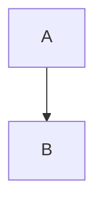

# {{PLAN_TITLE}}

<a id="how-to-use"></a>
## How to use this plan

This plan is self-contained for orchestration by a fresh agent session.

- All implementation subagents must run in fresh context.
- Execute only assignable unit IDs listed in the orchestration waves.
- Before launching a unit, pass its full `Subagent prompt` plus the relevant plan references from `Canonical Line References`.
- Do not infer requirements from outside this plan and the listed references.
- Do not execute neighboring task scopes.
- If a unit is marked `non-validating`, do not run global validation or add compatibility workarounds to make the repo compile.
- Only units marked `integration-validating` own global validation gates.
- If blocked by missing context or unexpected codebase reality, report the blocker and stop instead of inventing a workaround.

<a id="legend"></a>
## Legend

### Execution

- `fresh`: subagent receives only the prompt, this plan, and listed references.
- `sequential`: must run after listed dependencies.
- `parallel`: may run in the same orchestration wave.
- `Assignable: yes`: this unit may be launched as a subagent task.
- `Assignable: no`: this unit is a container or explanatory grouping only.

### Validation responsibility

- `non-validating`: do not run global compile/lint/test gates; only perform explicitly listed local checks.
- `locally-validating`: validate only the owned scope.
- `integration-validating`: owns broader validation gates.

### Artifact tags

- `[CANONICAL]`: required shape; preserve unless implementation evidence contradicts it.
- `[ILLUSTRATIVE]`: explains intent; adapt to local architecture.

### Review flag types

- `BQ`: blocking question requiring human decision before affected work.
- `OQ`: non-blocking open question.
- `C`: contradiction or ambiguity.
- `R`: implementation risk / watch item.

### File actions

- `create`: file must be created.
- `modify`: file must be edited.
- `delete`: file must be removed.
- `read`: file/reference must be read before editing.

<a id="goal"></a>
## Goal

{{GOAL}}

<a id="non-goals"></a>
## Non-goals

{{NON_GOALS}}

<a id="review-flags"></a>
## Review Flags

| ID | Type | Severity | Summary | Affects | Follow-up / accepted risk |
|---|---|---:|---|---|---|
| {{RF_ID}} | {{TYPE}} | {{SEVERITY}} | {{SUMMARY}} | {{AFFECTS}} | {{FOLLOW_UP}} |

<a id="global-acceptance"></a>
## Global Acceptance Criteria

{{GLOBAL_ACCEPTANCE_CRITERIA}}

<a id="legacy-policy"></a>
## Legacy / workaround policy

- No temporary aliases unless explicitly listed as allowed in a task.
- No compatibility shims unless they are the goal of a task.
- No type weakening to satisfy intermediate compilation.
- No preserving legacy names when the planned change is a removal or rename.
- Do not expand a task scope to fix breakages assigned to later units.
- If blocked, report the breakage and reference the downstream unit responsible.

<a id="breaking-changes"></a>
## Planned Breaking Changes and Propagation Map

| Change | Introduced by | Expected temporary breakage | Fixed by | Forbidden workaround |
|---|---|---|---|---|
| {{CHANGE}} | {{INTRODUCED_BY}} | {{EXPECTED_BREAKAGE}} | {{FIXED_BY}} | {{FORBIDDEN_WORKAROUND}} |

<a id="orchestration"></a>
## Subagent Orchestration Plan

{{ORCHESTRATION_WAVES}}

<a id="parallelization-constraints"></a>
## Parallelization Constraints

| Constraint | Reason | Affected units |
|---|---|---|
| {{CONSTRAINT}} | {{REASON}} | {{AFFECTED_UNITS}} |

<a id="canonical-line-references"></a>
## Canonical Line References

<!-- CANONICAL_LINE_REFERENCES_START -->
<!-- This block is generated by finalize-plan-lines.mjs. Do not edit manually. -->
| ID | Anchor | Lines | Description |
|---|---|---|---|
| how-to-use | #how-to-use | L3-L15 | How to use this plan |
| legend | #legend | L17-L51 | Legend |
| goal | #goal | L53-L56 | Goal |
| non-goals | #non-goals | L58-L61 | Non-goals |
| review-flags | #review-flags | L63-L68 | Review Flags |
| global-acceptance | #global-acceptance | L70-L73 | Global Acceptance Criteria |
| legacy-policy | #legacy-policy | L75-L83 | Legacy / workaround policy |
| breaking-changes | #breaking-changes | L85-L90 | Planned Breaking Changes and Propagation Map |
| orchestration | #orchestration | L92-L95 | Subagent Orchestration Plan |
| parallelization-constraints | #parallelization-constraints | L97-L102 | Parallelization Constraints |
| canonical-line-references | #canonical-line-references | L104-L109 | Canonical Line References |
| phases-and-tasks | #phases-and-tasks | L111-L195 | Phases and Tasks |
| P1.T1 | #P1.T1 | L119-L195 | Task P1.T1 — <name> |
| pre-finalization-review | #pre-finalization-review | L197-L204 | Pre-finalization Review Summary |
<!-- CANONICAL_LINE_REFERENCES_END -->

<a id="phases-and-tasks"></a>
## Phases and Tasks

{{PHASES_AND_TASKS}}

<!--
Suggested assignable unit shape:

<a id="P1.T1"></a>
### Task P1.T1 — <name>

Assignable: yes

Execution metadata:
- Wave: W1
- Context: fresh
- Depends on: none
- Can run in parallel with: P1.T2
- Must not run in parallel with: none

Scope boundaries:
- Goal:
- Non-goals:
- Forbidden work:

Files:
| Action | Path | Purpose |
|---|---|---|
| modify | path/to/file.ts | |

Required context package:
- Plan references: use `Canonical Line References` for P1.T1, orchestration wave, affected review flags, and dependency outputs.
- Required skills:
- Required files/symbols to read:
- Required URLs/docs:
- Dependency outputs to read:
- Neighboring out-of-scope units:

Implementation outline:
1.
2.

Major snippets:

#### [CANONICAL] <snippet name>
```ts
...
```

Explanatory artifacts:

#### [ILLUSTRATIVE] <artifact name>


Validation responsibility:
- Type: non-validating | locally-validating | integration-validating
- Must run:
- Must NOT run:
- Expected temporary breakage:
- Forbidden fixes/workarounds:

Output contract:
-

Acceptance criteria:
-

Handoff to dependent units:
-

Subagent prompt:
```text
You are implementing only <UNIT_ID> from <PLAN_PATH>.
Run in fresh context. Read the plan references and required files listed in this unit before editing.
Do not edit outside the listed file scope unless you first report why the plan is insufficient.
Do not implement neighboring units.
Respect the validation responsibility exactly: do not run commands listed under Must NOT run.
If blocked, report the blocker, affected files, and which downstream unit or review flag is relevant.

Task: <summary>
```
-->

<a id="pre-finalization-review"></a>
## Pre-finalization Review Summary

| Reviewer | Status | Required changes applied | Remaining concerns |
|---|---|---|---|
| Feasibility / file references | {{STATUS}} | {{CHANGES}} | {{CONCERNS}} |
| Sequencing / dependency graph | {{STATUS}} | {{CHANGES}} | {{CONCERNS}} |
| Scope isolation / prompt quality | {{STATUS}} | {{CHANGES}} | {{CONCERNS}} |
